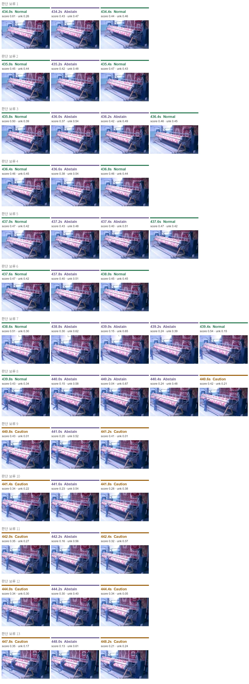
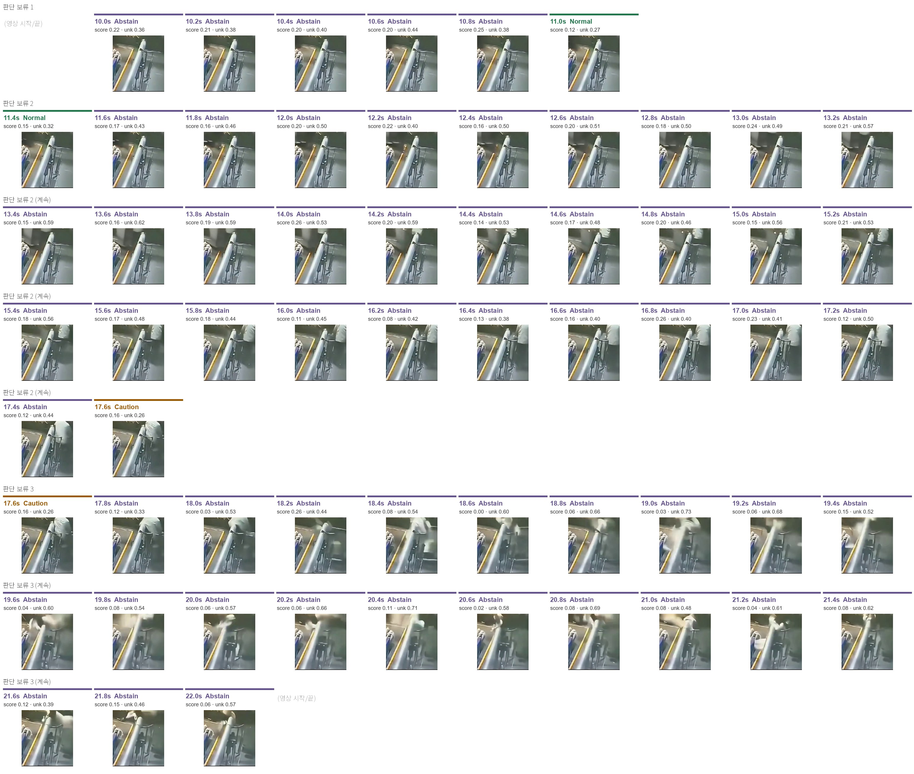
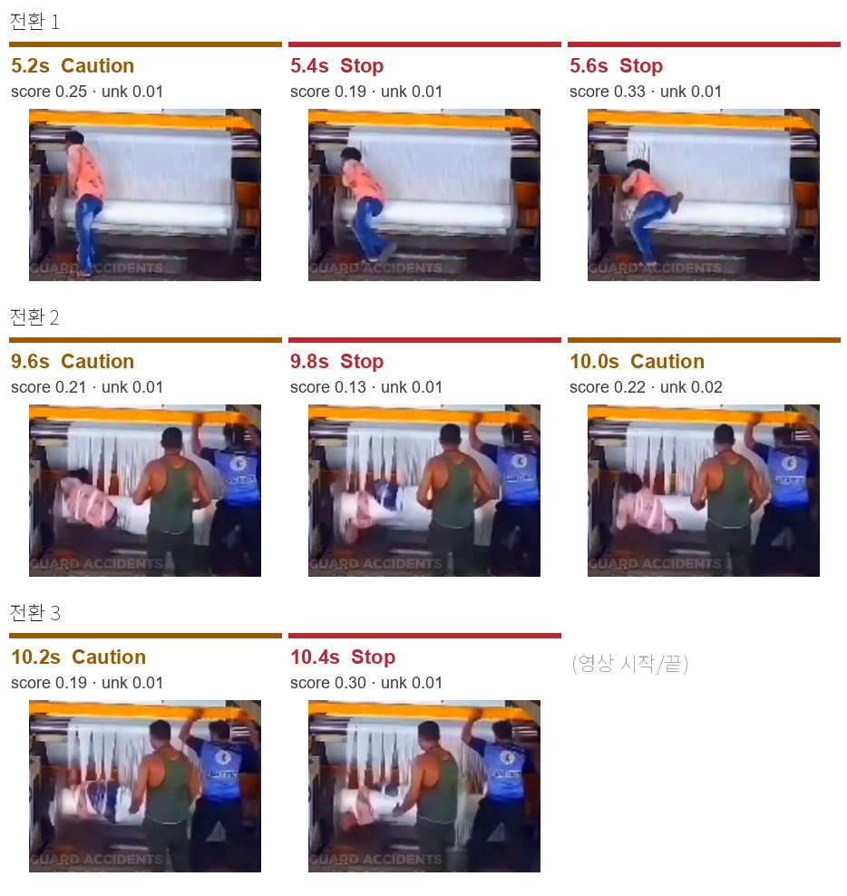
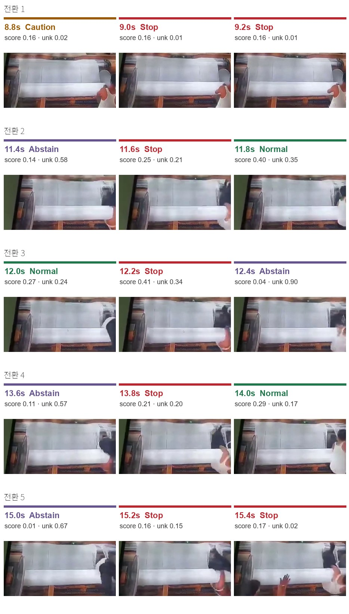
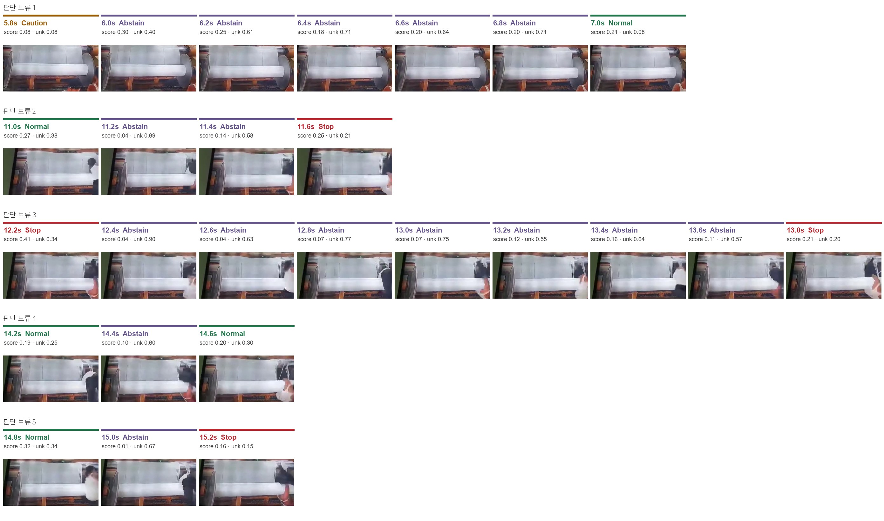
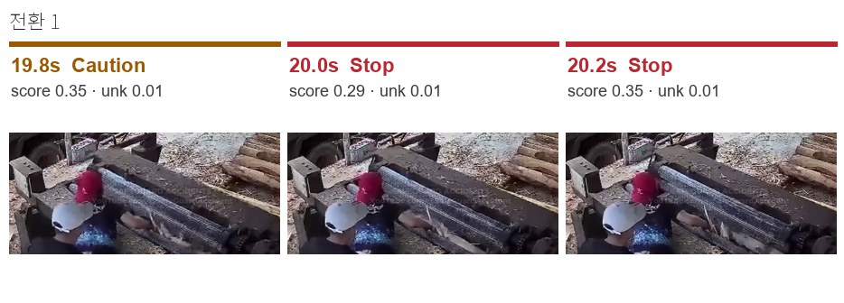
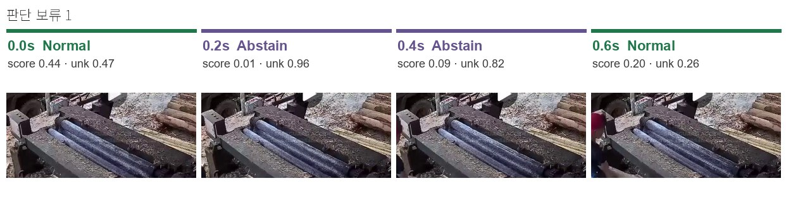

# OmniGuard ImaJEV 실험

**374장 모두 0.3초 안에 처리했지만(평균 0.133초), 판단 보류가 25.1%였고 Stop은 D01·D03·D04 세 장면에서만 나와 정지 제어에 바로 쓰기에는 보완이 필요했다.**

## 실험 방법

- 모델: `mohit67890/imajev-4b`, 어댑터 `c9e5f132`, 공식 PyTorch 서버 사용
- 실행: A100 80GB, `FAST=True`, `--rotations 1`, `--thinking off` ([실행 기록](OmniGuard_Imajev_Colab_output.ipynb))
- 데이터: `data/frames.zip`. 공장 사고 영상 5개(A04_carpet, A09_pipe, D01, D03, D04)에서 추출한 374프레임, 0.2초 간격, 해상도 468×347~1221×597. 영상 사이의 검은 제목 화면은 뺐다.
- 방법: 프레임마다 Normal(정상) / Caution(주의) / Stop(정지) 중 하나를 고르게 하고, 모델이 판단 불가로 본 프레임은 판단 보류(`abstained=True`)로 구분. 판정 기준은 vlm 실험(Qwen3.8-27B)과 같다.

이전 입력 `data.zip`(371장)으로 실행한 결과는 커밋 `b466b10`의 `results/imajev/`에 있다. 입력이 달라 수치를 직접 비교하지 않는다.

## 결과

| 항목 | 결과 |
|---|---:|
| Normal | 58장 · 15.5% |
| Caution | 182장 · 48.7% |
| Stop | 40장 · 10.7% |
| 판단 보류 | **94장 · 25.1%** |
| 처리 오류 | 0장 |
| 평균 처리 시간 | **0.133초/장** |
| 처리 시간 P95 | 0.189초 |
| 기존 목표 0.3초 이내 | 374장 · 100% |

| 장면 | 해상도 | 장수 | Normal | Caution | Stop | 판단 보류 | 판정 변경 | 평균 처리 시간 |
|---|---|---:|---:|---:|---:|---:|---:|---:|
| A04_carpet | 671×396 | 81 | 24 | 38 | 0 | 19 | **26회** | 0.114초 |
| A09_pipe | 536×584 | 61 | 3 | 1 | 0 | **57** | 4회 | 0.121초 |
| D01 | 468×347 | 53 | 2 | 29 | 22 | 0 | 9회 | 0.107초 |
| D03 | 1221×597 | 70 | 27 | 18 | 9 | 16 | **28회** | 0.189초 |
| D04 | 943×425 | 109 | 2 | 96 | 9 | 2 | 4회 | 0.132초 |

판정 변경은 바로 앞 프레임과 판정이 다른 횟수다. Stop 연속 구간 9개 중 5개는 한 프레임만 Stop이었다(D01 9.8·10.4초, D03 11.6·12.2·13.8초).
처리 시간은 이미지가 가장 큰 D03이 가장 길었다. 시간은 CSV의 `elapsed_ms` 기준이며, 영상 입력부터 설비 정지까지의 전체 지연은 확인하지 못했다.

모델은 판정마다 점수(`confidence`)와 판단 불가 확률(`unknown_probability`)을 낸다. 판단 불가 확률의 중앙값은 판단 보류 프레임에서 0.54, Normal 0.18, Stop 0.02, Caution 0.01이었다.
판단 불가 확률이 0.47 이상인 프레임(69장)은 모두 판단 보류였고, 0.47 이상인데 판정이 나온 프레임은 없었다. 반면 0.47 미만인데도 보류된 프레임이 25장(그중 21장이 A09_pipe) 있었고, 이들은 점수로도 구분되지 않아 보류 기준은 확인하지 못했다. 점수의 정의·보정 여부도 미확인이다.

### 같은 374장에서 Qwen3.8-27B와 비교

| 장면 | Stop (imajev / Qwen) | 판단 보류 (imajev / Qwen) | 판정 일치 |
|---|---:|---:|---:|
| A04_carpet | 0 / 41 | 19 / 0 | 26/81 |
| A09_pipe | 0 / 12 | 57 / 17 | 17/61 |
| D01 | 22 / 35 | 0 / 0 | 38/53 |
| D03 | 9 / 34 | 16 / 12 | 27/70 |
| D04 | 9 / 69 | 2 / 0 | 45/109 |
| 합계 | **40 / 191** | **94 / 29** | 153/374 · 40.9% |

imajev가 Stop으로 판정한 40장 중 39장은 Qwen도 Stop이었다. imajev는 Stop을 훨씬 적게 냈고, 대신 판단 보류가 세 배 이상 많았다.
정답 라벨이 없어 어느 쪽이 맞는지는 판단하지 않는다. Qwen 결과는 vlm 실험(`exp/vlm`)의 `results/qwen38/omniguard_qwen38_results.csv`다.

## 장면별 판정: Stop 전환과 판단 보류

장면마다 앞 프레임이 Stop이 아니었다가 Stop으로 바뀐 지점을 모두 모았다(9곳, A04_carpet과 A09_pipe에는 Stop이 없다). 이미지는 한 줄이 전환 하나이며, 왼쪽부터 앞 프레임 · Stop 첫 프레임 · 뒤 프레임이다.
판단 보류는 구간마다 앞 프레임 · 보류 프레임 전부 · 뒤 프레임을 한 줄로 붙였다(94장 전부). 10장이 넘는 구간은 여러 줄로 나눴다.
시각은 영상 속 시각이다. 판정 아래 `score`는 점수, `unk`는 판단 불가 확률이다. `Abstain`은 판단 보류다.

모델은 판정과 점수만 출력하고 이유는 내지 않는다. 아래 "화면" 열은 프레임을 직접 보고 적은 관찰이고, 판단 보류의 "추론한 이유"는 그 관찰과 판단 불가 확률에서 추론한 것이다.

### 1. A04_carpet: Stop 없음, 비슷한 화면에서 판단 보류가 끼어듦 (판단 보류 19장)

Stop은 한 번도 나오지 않았다. 같은 구간에서 Qwen은 440.4초부터 41장을 Stop으로 판정했다.

| # | 판단 보류 구간 | 장수 | 앞 → 뒤 | 추론한 이유 |
|---|---|---:|---|---|
| 1~6 | 434.2~437.8s (6구간) | 8 | Normal → Normal | 작업자가 화면에 거의 보이지 않는 롤러 화면이다. 앞뒤 Normal과 화면이 거의 같다. 보류 8장의 판단 불가 확률은 0.47~0.54로, 같은 구간 Normal의 상당수(0.39~0.46)보다 조금 높을 뿐이어서 0.47 근처의 경계에서 흔들린 것으로 보인다 |
| 7 | 438.8~439.2s | 3 | Normal → Normal | 작업자가 왼쪽에서 화면 안으로 들어오는 중이라 몸 일부만 보인다 |
| 8 | 440.0~440.4s | 3 | Normal → Caution | 작업자가 롤러 쪽으로 다가가 팔을 들기 시작한다. 440.2초의 판단 불가 확률이 0.87로 이 장면에서 가장 높다 |
| 9~13 | 441.0~448.0s (5구간) | 5 | Caution → Caution | 작업자가 롤러 앞에 서서 팔을 뻗은 Caution 화면 사이에 한 장씩 끼었다. 앞뒤와 화면 차이가 거의 없다 |

판정 변경 26회 중 대부분이 Normal·Caution과 판단 보류 사이를 오간 것이다. 화면 변화보다 판단 불가 확률이 기준값 근처에서 오르내린 결과로 보인다.

### 2. A09_pipe: 대부분 판단 보류 (판단 보류 57장)

Stop은 없고, 61장 중 57장을 판단 보류했다. 판정이 나온 4장(Normal 3, Caution 1)도 점수가 0.11~0.18로 낮았다. 이 장면은 판단 불가 확률이 0.47 미만인데도 보류된 프레임이 21장으로 가장 많다.

| # | 판단 보류 구간 | 장수 | 앞 → 뒤 | 추론한 이유 |
|---|---|---:|---|---|
| 1 | 10.0~10.8s | 5 | (영상 시작) → Normal | 흐린 정지 화면이다. 작업자가 가운데 기둥 뒤에 가려져 손·팔이 보이지 않는다 |
| 2 | 11.6~17.4s | 30 | Normal → Caution | 1번과 같은 흐린 화면이 이어진다. 13초 이후에는 파이프 위쪽에 밝은 색 사람 형체가 보이지만 흐려서 자세를 알기 어렵다 |
| 3 | 17.8~22.0s | 22 | Caution → (영상 끝) | 사람(또는 물체)이 빠르게 움직여 크게 번졌다. 22장 중 18장의 판단 불가 확률이 0.48 이상(최대 0.73)으로, 이 장면에서 가장 높다 |

화면 전체가 흐리고 작업자가 가려지거나 번져, 모델이 위험 여부를 판단할 근거를 찾지 못한 것으로 보인다. 같은 장면에서 Qwen은 Stop 12장을 냈지만, 흐린 화면에서 판정이 32번 바뀌었다.

### 3. D01 롤러: 롤에 올라타면 Stop, 감긴 뒤에는 Caution과 오감 (전환 3곳, 판단 보류 없음)

| # | 앞 | Stop | 뒤 | 화면 |
|---|---|---|---|---|
| 1 | 5.2s Caution | 5.4s | 5.6s Stop | 작업자가 회전하는 롤 위로 올라탄다. 9.2초까지 20장 연속 Stop |
| 2 | 9.6s Caution | 9.8s | 10.0s Caution | 작업자가 롤에 감긴 채이고 동료 두 명이 옆에 서 있다. 앞뒤 Caution과 화면이 거의 같다 |
| 3 | 10.2s Caution | 10.4s | (영상 끝) | 2번과 같은 상황 |

1번은 몸이 롤에 올라탄 순간 Stop으로 바뀌어 화면 내용과 맞는다. 반면 9.4초 이후에는 사람이 롤에 감겨 있는데도 Caution이 대부분이고 Stop은 한 장씩만 나왔다(2·3번). 점수도 0.13~0.30으로 낮았다.
같은 구간에서 Qwen은 4.0초부터 끝까지 Stop을 유지했다.

### 4. D03 롤러: 롤러 끝의 신체 일부로 Stop·Normal·판단 보류가 오감 (전환 5곳, 판단 보류 16장)

| # | 앞 | Stop | 뒤 | 화면 |
|---|---|---|---|---|
| 1 | 8.8s Caution | 9.0s | 9.2s Stop | 작업자가 롤러 오른쪽 끝으로 손을 뻗는다. 9.4초까지 3장 연속 Stop |
| 2 | 11.4s 판단 보류 | 11.6s | 11.8s Normal | 롤러 오른쪽 끝에 팔 일부가 보이고 몸 대부분은 화면 밖이다 |
| 3 | 12.0s Normal | 12.2s | 12.4s 판단 보류 | 2번과 비슷한 화면 |
| 4 | 13.6s 판단 보류 | 13.8s | 14.0s Normal | 2번과 비슷한 화면 |
| 5 | 15.0s 판단 보류 | 15.2s | 15.4s Stop | 롤러 끝에서 작업자의 몸이 롤러에 걸린 것으로 보인다. 15.6초까지 3장 연속 Stop |

2~4번은 비슷한 화면에서 한 장만 Stop이 나오고, 바로 Normal이나 판단 보류로 바뀌었다. 판정 변경 28회로 다섯 장면 중 가장 많다.

| # | 판단 보류 구간 | 장수 | 앞 → 뒤 | 추론한 이유 |
|---|---|---:|---|---|
| 1 | 6.0~6.8s | 5 | Caution → Normal | 롤러만 보이고 사람이 거의 보이지 않는다(판단 불가 확률 0.40~0.71). 판정할 대상이 없는 화면으로 보인다 |
| 2 | 11.2~11.4s | 2 | Normal → Stop | 롤러 오른쪽 가장자리에 몸 일부만 보이고 나머지는 화면 밖으로 잘렸으며, 움직임으로 번졌다. 신체가 위험 구역 안인지 밖인지 화면만으로 정하기 어렵다 |
| 3 | 12.4~13.6s | 7 | Stop → Stop | 2번과 같음. 12.4초의 판단 불가 확률이 0.90으로 이 장면에서 가장 높다. 앞뒤가 모두 Stop인데 사이 7장이 보류였다 |
| 4 | 14.4s | 1 | Normal → Normal | 2번과 같음 |
| 5 | 15.0s | 1 | Normal → Stop | 2번과 같음. 바로 다음 15.2초부터 Stop이 이어진다 |

D03의 판단 보류는 사람이 화면에 거의 없는 경우(1번)와, 신체가 화면 가장자리에서 잘리고 번져 롤러와의 위치 관계가 불분명한 경우(2~5번)에 나왔다.

### 5. D04 롤러: 머리가 롤러 위에 있는 마지막 구간에서만 Stop (전환 1곳, 판단 보류 2장)

| # | 앞 | Stop | 뒤 | 화면 |
|---|---|---|---|---|
| 1 | 19.8s Caution | 20.0s | 20.2s Stop | 빨간 모자를 쓴 작업자의 머리가 롤러 위에 있고, 앞쪽에 다른 작업자가 있다. 영상 끝(21.6초)까지 9장 연속 Stop |

Stop은 영상 마지막 9장뿐이고, 19.8초(Caution)와 20.0초(Stop)는 화면 차이가 작다. 그 전 96장은 대부분 Caution이었다.
Qwen은 같은 장면에서 손을 롤러 위 통나무에 댄 2.0초부터 Stop을 냈고(69장), imajev의 Stop 9장은 Qwen도 모두 Stop이었다.

| # | 판단 보류 구간 | 장수 | 앞 → 뒤 | 추론한 이유 |
|---|---|---:|---|---|
| 1 | 0.2~0.4s | 2 | Normal → Normal | 작업자가 화면에 없는 빈 설비 화면이다. 판단 불가 확률이 0.96·0.82로 전체에서 가장 높다. 0.6초에 작업자 팔이 들어오자 Normal로 바뀌었다 |

