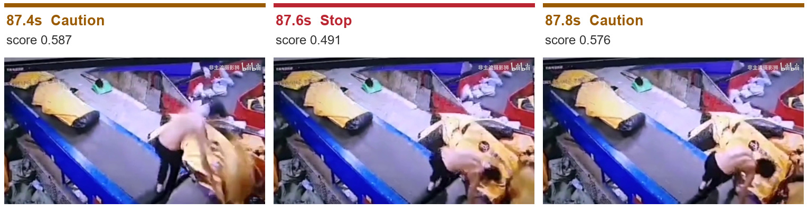
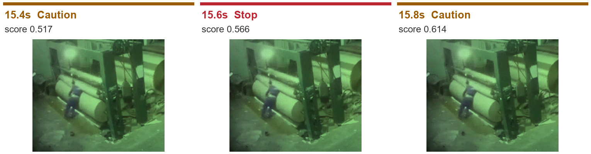
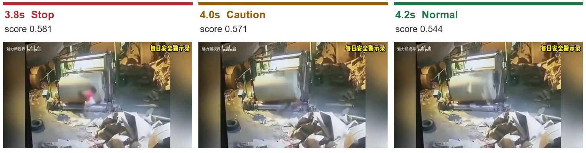

# OmniGuard 기본 모델 실험

**기본 모델만으로는 Stop 판정이 안정적이지 않았고, 한 장 판단에 약 3.13초가 걸려 실시간 대응에 부족했다.**

## 실험 방법

- 모델: `Remek/basal-omni-1.0-ultra`를 추가 학습 없이 사용
- 실행: A100 80GB, `DETAIL=high`, 선택지 순서 1회 평가 ([실행 기록](OmniGuard_Basal_Colab_output.ipynb))
- 데이터: 공장 영상 5개에서 추출한 371프레임, 0.2초 간격
- 방법: 한 장씩 입력해 Normal(정상) / Caution(주의) / Stop(정지)으로 분류

## 결과

| 항목 | 결과 |
|---|---:|
| Normal | 20장 · 5.4% |
| Caution | 345장 · 93.0% |
| Stop | 6장 · 1.6% |
| 평균 판단 시간 | **3.13초/장** |
| 기존 목표 0.3초 대비 | **약 10.4배 오래 걸림** |

371장 모두 처리됐고 오류는 없었다. 그러나 Stop이 이어진 4개 구간 중 **3개는 한 프레임만 Stop**이었다.

## 판정이 바뀐 주요 장면

이미지는 왼쪽부터 시간순이다. 표시된 시각은 영상 속 시각이며, 점수는 모델의 선택 점수다.

### 1. 컨베이어: Stop 직후 Caution으로 복귀

87.6초에만 Stop이 나타났고, 다음 프레임에서 다시 Caution으로 바뀌었다.

### 2. 야간 작업: Stop이 한 프레임만 나타남

15.6초에 Stop으로 판단했지만, 앞뒤 프레임은 모두 Caution이었다.

### 3. 종이 권취기: Stop 이후 Normal로 변경

작업자를 계속 명확히 확인하기 어려운 구간인데도 Stop → Caution → Normal로 바뀌었다. 이 Normal을 안전이 확인됐다는 뜻으로 사용할 수는 없다.

