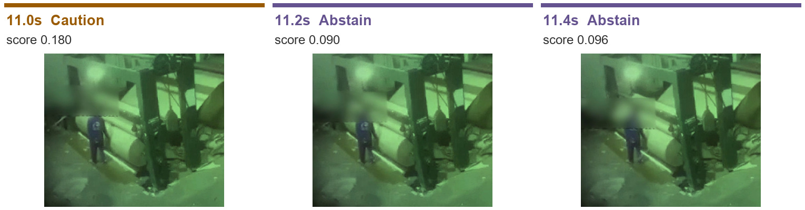
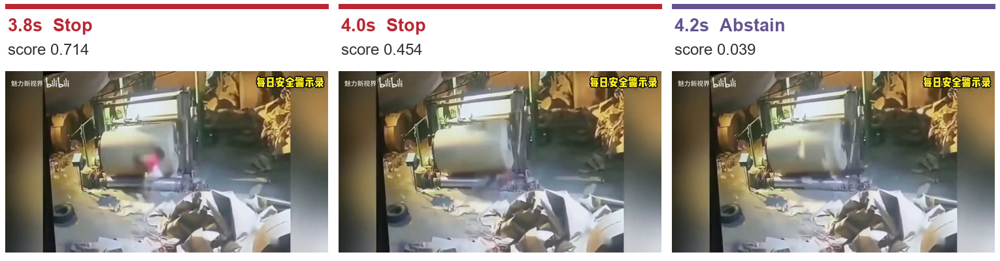

# OmniGuard ImaJEV 실험

**평균 처리 시간은 0.229초였지만, Stop 판정의 반복 변화와 판단 보류가 있어 정지 제어에 바로 쓰기에는 보완이 필요했다.**

## 실험 방법

- 모델: `mohit67890/imajev-4b`, 어댑터 `c9e5f132`, 공식 PyTorch 서버 사용
- 실행: A100 80GB, `FAST=True`, `--rotations 1`, `--thinking off` ([실행 기록](OmniGuard_Imajev_Colab_output.ipynb))
- 데이터: 공장 영상 5개에서 추출한 371프레임, 0.2초 간격
- 방법: 프레임별 Normal(정상) / Caution(주의) / Stop(정지) 출력과 처리 시간 분석. `abstained=True`는 판단 보류로 구분

## 결과

| 항목 | 결과 |
|---|---:|
| Normal | 70장 · 18.9% |
| Caution | 256장 · 69.0% |
| Stop | 16장 · 4.3% |
| 판단 보류 | **29장 · 7.8%** |
| 평균 처리 시간 | **0.229초/장** |
| 처리 시간 P95 | 0.427초 |
| 기존 목표 0.3초 이내 | 321장 · 86.5% |

처리 오류는 없었다. 종이 권취기 50장은 모두 0.3초를 넘었으며, Stop 연속 구간 8개 중 **4개는 한 프레임만 Stop**이었다.

시간은 CSV의 `elapsed_ms` 기준이다. P95는 95%의 프레임이 해당 시간 이내에 처리됐다는 뜻이며, 영상 입력부터 설비 정지까지의 전체 지연은 확인하지 못했다.

## 판정이 바뀐 주요 장면

이미지는 왼쪽부터 시간순이다. 시각은 영상 속 시각이다. `Abstain`은 판단 보류이며, `score`의 정의·보정 여부는 미확인이다.

### 1. 컨베이어: Stop 직후 Normal로 복귀

88.4초에만 Stop이 나타났고, 앞뒤 프레임은 Normal이었다. 다음 Normal만으로 안전 복귀를 확인할 수는 없다.

### 2. 야간 작업: 판단 보류가 이어짐

11.2~12.8초의 9프레임에서 판단을 보류했다. 야간 장면 전체에서는 73장 중 13장이 보류됐고, Stop은 없었다.

### 3. 종이 권취기: Stop 이후 판단 보류

3.8·4.0초는 Stop, 4.2초부터는 판단 보류였다. 보류를 Normal로 바꾸거나 정지 해제 근거로 사용해서는 안 된다.

