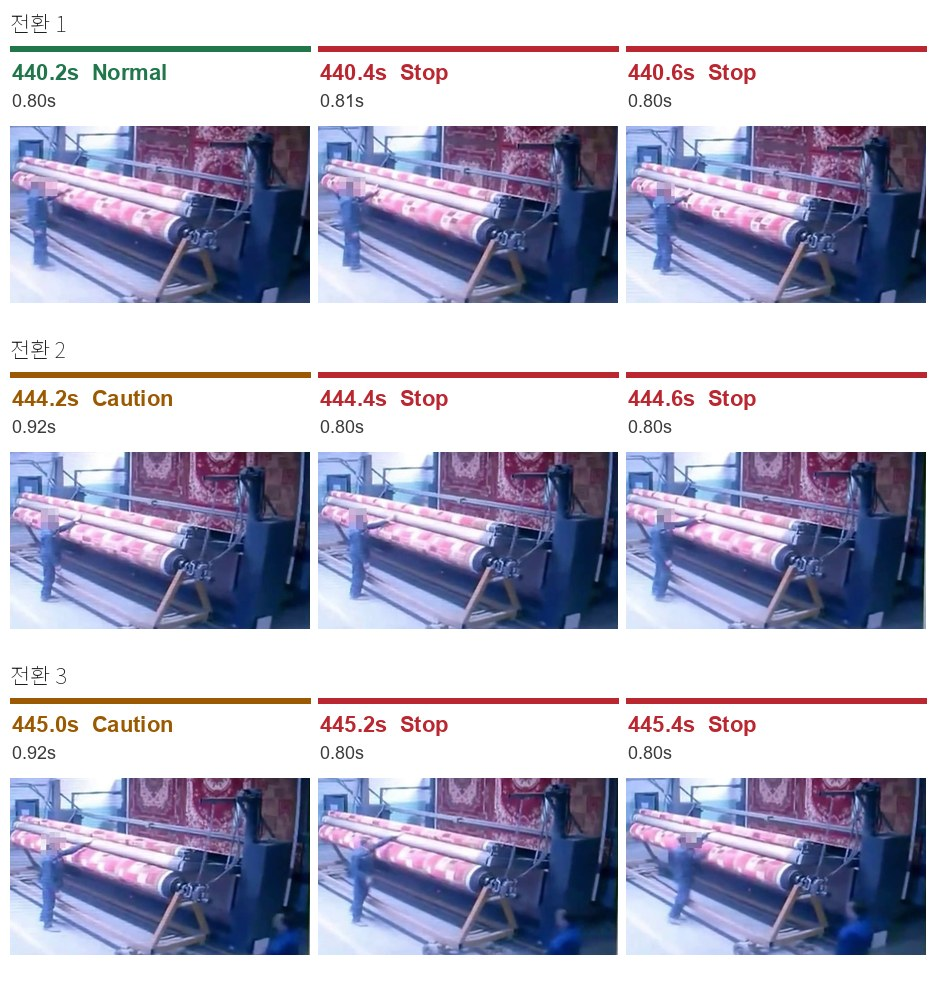
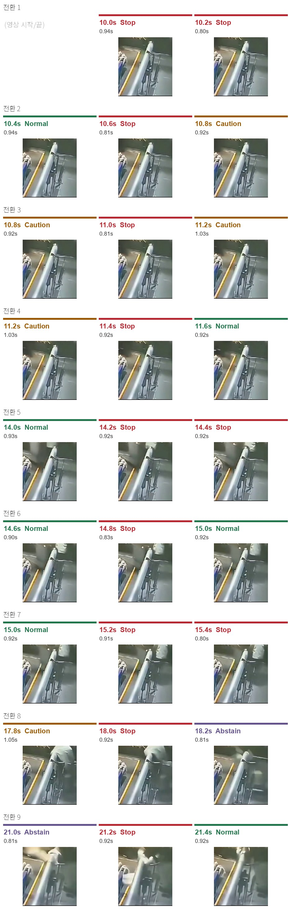
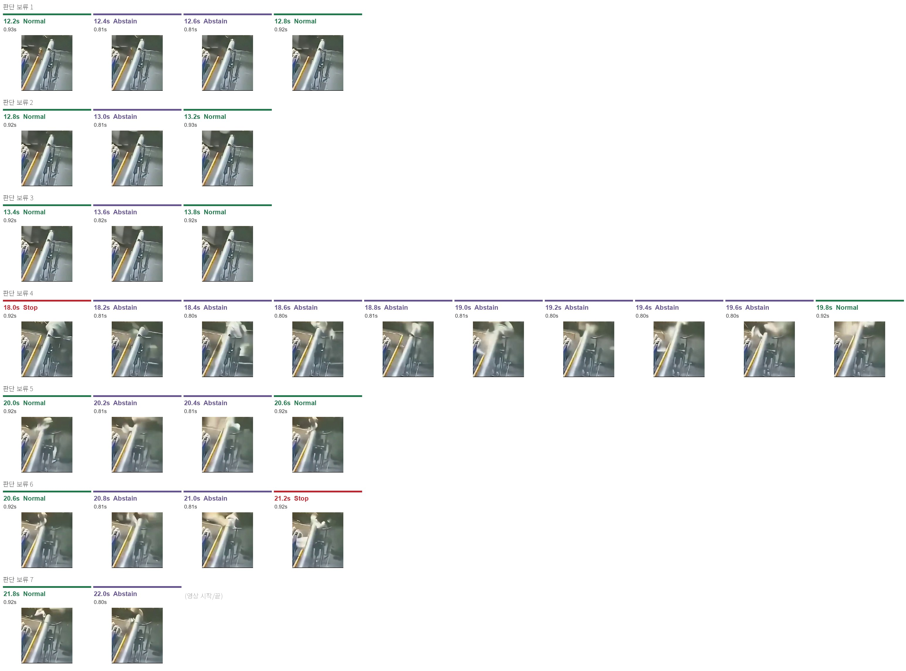
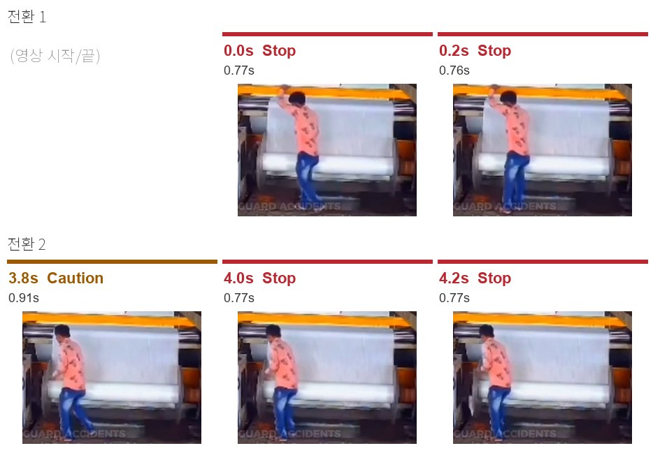
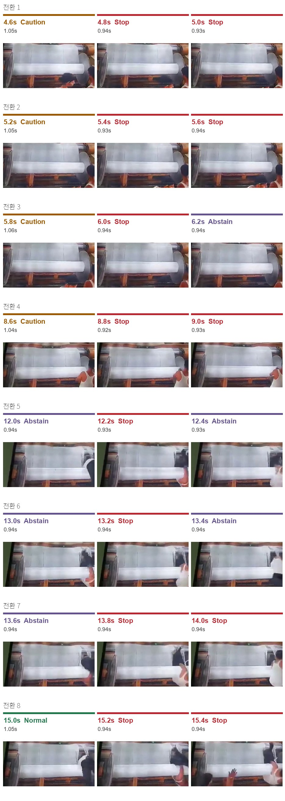
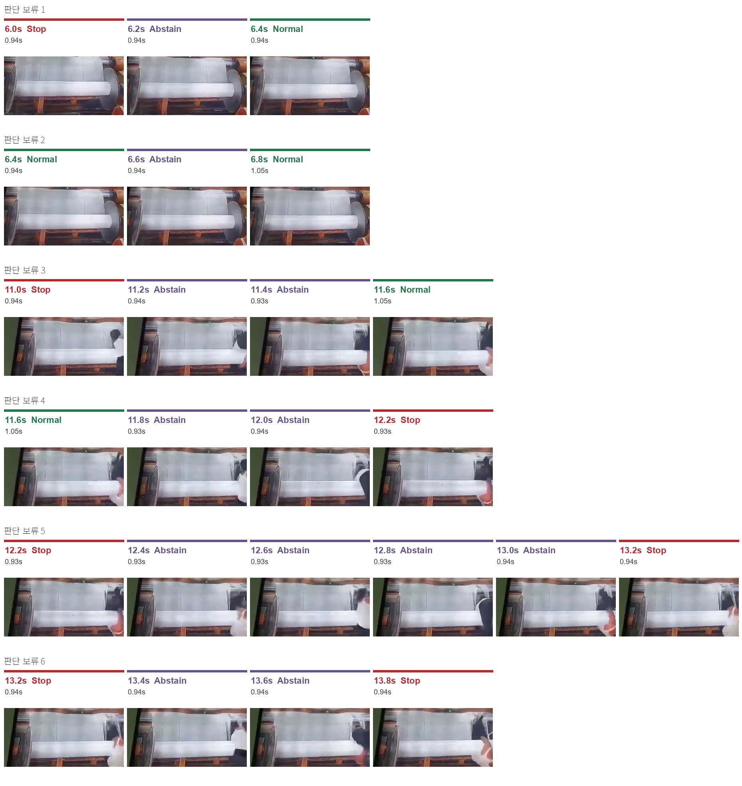
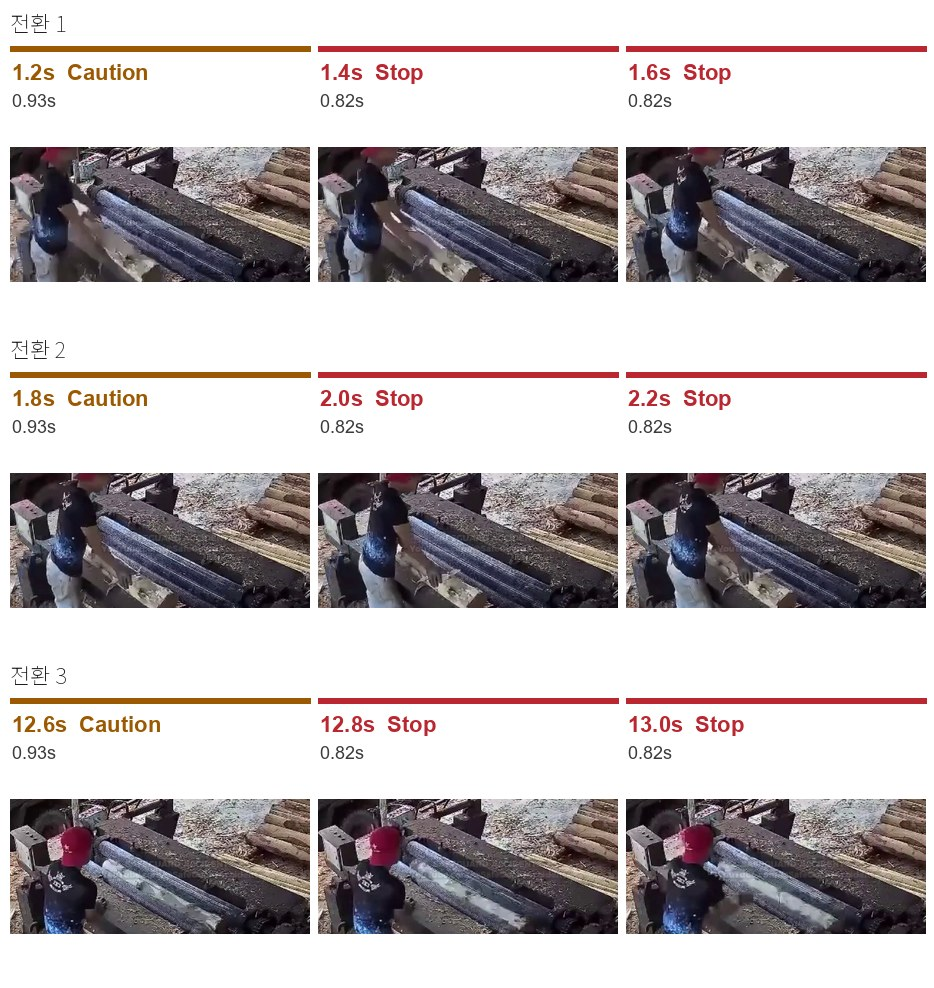

# OmniGuard Qwen3.8-27B 실험

**374장을 형식 오류 없이 분류했지만 한 장에 평균 0.87초가 걸려 0.3초 목표를 한 장도 맞추지 못했고, Stop을 51%로 판정해 같은 입력의 imajev(11%)보다 훨씬 자주 정지를 요구했다.**

## 실험 방법

- 모델: `Qwen/Qwen3.8-27B`(revision `1d4bf0f2`)를 추가 학습 없이 사용, transformers 5.19.0
- 실행: A100 80GB, BF16(양자화·CPU offload 없음), thinking 끔, 샘플링 없이 최대 16토큰, batch_size=1 ([실행 기록](OmniGuard_Qwen38_Colab_output.ipynb), [실행 설정](run_config.json))
- 데이터: `data/frames.zip`. 공장 사고 영상 5개(A04_carpet, A09_pipe, D01, D03, D04)에서 추출한 374프레임, 0.2초 간격. 이미지는 원본 해상도 그대로 입력했다.
- 방법: 프레임마다 대화 이력 없이 `{"stage": ...}` JSON 하나를 생성하게 해 Normal(정상) / Caution(주의) / Stop(정지)으로 분류. 근거가 부족하면 `null`(판단 보류). 판정 기준은 jev 실험과 같다.

직전에는 D04 끝의 검은 제목 화면 4장을 포함한 378장으로 실행했다([실행 기록](OmniGuard_Qwen38_Colab_output_378.ipynb)).
이번 374장 실행의 판정 개수는 그때와 같았고, 판단 보류만 33장에서 29장으로 줄었다(제목 화면 4장은 모두 판단 보류였다). 378장 실행의 CSV는 남아 있지 않아 프레임별 일치는 확인하지 못했다.

## 결과

| 항목 | 결과 |
|---|---:|
| Normal | 75장 · 20.1% |
| Caution | 79장 · 21.1% |
| Stop | **191장 · 51.1%** |
| 판단 보류 | 29장 · 7.8% |
| 형식 오류 | 0장 |
| 평균 처리 시간 | **0.867초/장** |
| 처리 시간 P95 | 1.036초 |
| 기존 목표 0.3초 이내 | **0장 · 0%** |

| 장면 | 해상도 | 이미지 토큰 | 장수 | Normal | Caution | Stop | 판단 보류 | 판정 변경 | 평균 처리 시간 |
|---|---|---:|---:|---:|---:|---:|---:|---:|---:|
| A04_carpet | 671×396 | 252 | 81 | 36 | 4 | 41 | 0 | 7회 | 0.821초 |
| A09_pipe | 536×584 | 306 | 61 | 26 | 6 | 12 | 17 | **32회** | 0.885초 |
| D01 | 468×347 | 165 | 53 | 0 | 18 | 35 | 0 | 2회 | 0.811초 |
| D03 | 1221×597 | 722 | 70 | 7 | 17 | 34 | 12 | **25회** | 0.969초 |
| D04 | 943×425 | 377 | 109 | 6 | 34 | 69 | 0 | 10회 | 0.852초 |

판정 변경은 바로 앞 프레임과 판정이 다른 횟수다. Stop 연속 구간 25개 중 9개는 한 프레임만 Stop이었고, 그중 6개가 A09_pipe, 3개가 D03이었다.

시간은 CSV의 `elapsed_ms`(이미지 읽기부터 응답 파싱까지) 기준이다. 이 중 `model.generate` 구간(`inference_ms`)이 평균 0.850초로 대부분을 차지했다.
처리 시간은 출력 토큰 수에 따라 두 무리로 나뉘었다. `{"stage":"Stop"}`처럼 6토큰인 응답은 중앙값 약 0.81초, `Caution`(`Ca`+`ution`)이나 공백이 들어간 `{"stage": "Normal"}`처럼 7토큰인 응답은 약 0.92초였다.
토큰 하나를 생성하는 데 약 0.1초가 들어, 이미지 처리보다 출력 토큰 생성이 시간의 대부분을 차지한다. 영상 입력부터 설비 정지까지의 전체 지연은 확인하지 못했다.

### 같은 374장에서 imajev와 비교

| 장면 | Stop (Qwen / imajev) | 판단 보류 (Qwen / imajev) | 판정 일치 |
|---|---:|---:|---:|
| A04_carpet | 41 / 0 | 0 / 19 | 26/81 |
| A09_pipe | 12 / 0 | 17 / 57 | 17/61 |
| D01 | 35 / 22 | 0 / 0 | 38/53 |
| D03 | 34 / 9 | 12 / 16 | 27/70 |
| D04 | 69 / 9 | 0 / 2 | 45/109 |
| 합계 | **191 / 40** | 29 / 94 | 153/374 · 40.9% |

imajev가 Stop으로 판정한 40장 중 39장은 Qwen도 Stop이었다. 차이는 대부분 imajev가 Normal·Caution·판단 보류로 둔 프레임을 Qwen이 Stop으로 판정한 데서 나왔다.
정답 라벨이 없어 어느 쪽이 맞는지는 판단하지 않는다. imajev 결과는 jev 실험(`exp/jev`)의 `results/omniguard_imajev_results.csv`다.

## 장면별 판정: Stop 전환과 판단 보류

장면마다 앞 프레임이 Stop이 아니었다가 Stop으로 바뀐 지점을 모두 모았다(25곳). 이미지는 한 줄이 전환 하나이며, 왼쪽부터 앞 프레임 · Stop 첫 프레임 · 뒤 프레임이다.
판단 보류가 나온 A09_pipe와 D03은 보류 구간마다 앞 프레임 · 보류 프레임 전부 · 뒤 프레임을 한 줄로 붙였다(29장 전부).
시각은 영상 속 시각이고, 판정 아래 숫자는 그 프레임의 처리 시간이다. `Abstain`은 판단 보류다.

모델은 JSON 판정만 출력하고 이유는 내지 않는다. 아래 "화면" 열은 프레임을 직접 보고 적은 관찰이고, 판단 보류의 "추론한 이유"는 그 관찰에서 추론한 것이다.

### 1. A04_carpet: 팔을 롤러로 뻗을 때 Stop (전환 3곳, 판단 보류 없음)

| # | 앞 | Stop | 뒤 | 화면 |
|---|---|---|---|---|
| 1 | 440.2s Normal | 440.4s | 440.6s Stop | 롤러 왼쪽에 선 작업자가 팔을 롤러 쪽으로 뻗기 시작한다. 이후 18장 연속 Stop |
| 2 | 444.2s Caution | 444.4s | 444.6s Stop | 팔을 롤러 위로 뻗고 있다. 앞 프레임과 자세 차이는 작다 |
| 3 | 445.0s Caution | 445.2s | 445.4s Stop | 팔을 롤러 쪽으로 뻗은 자세가 이어진다. 오른쪽 아래에 다른 작업자가 들어온다. 이후 영상 끝까지 Stop |

Stop은 작업자가 팔을 롤러 쪽으로 뻗은 자세와 맞물려 나왔다. 2·3번은 앞 프레임(Caution)과 화면 차이가 작아, Caution과 Stop의 경계가 비슷한 자세에서 갈렸다.

### 2. A09_pipe: 흐린 화면에서 Stop이 근거 없이 오감 (전환 9곳, 판단 보류 17장)

| # | 앞 | Stop | 뒤 | 화면 |
|---|---|---|---|---|
| 1 | (영상 시작) | 10.0s | 10.2s Stop | 흐린 정지 화면. 작업자는 가운데 기둥 뒤에 가려져 있다 |
| 2 | 10.4s Normal | 10.6s | 10.8s Caution | 1번과 거의 같은 화면 |
| 3 | 10.8s Caution | 11.0s | 11.2s Caution | 1번과 거의 같은 화면 |
| 4 | 11.2s Caution | 11.4s | 11.6s Normal | 1번과 거의 같은 화면 |
| 5 | 14.0s Normal | 14.2s | 14.4s Stop | 파이프 위쪽에 밝은 색 물체(사람으로 보임)가 나타난다 |
| 6 | 14.6s Normal | 14.8s | 15.0s Normal | 5번과 비슷한 화면 |
| 7 | 15.0s Normal | 15.2s | 15.4s Stop | 5번과 비슷한 화면 |
| 8 | 17.8s Caution | 18.0s | 18.2s 판단 보류 | 밝은 옷의 사람이 파이프 위쪽 장치에 몸을 기울인다. 다음 프레임부터 크게 번진다 |
| 9 | 21.0s 판단 보류 | 21.2s | 21.4s Normal | 밝은 물체가 번진 채 지나간다 |

1~4번은 화면이 거의 변하지 않는데 Stop · Normal · Caution이 번갈아 나왔으므로, 화면 근거보다 판정이 흔들린 결과로 본다. Stop 9곳 중 6곳이 한 프레임만 Stop이었다.

| # | 판단 보류 구간 | 장수 | 앞 → 뒤 | 추론한 이유 |
|---|---|---:|---|---|
| 1 | 12.4~12.6s | 2 | Normal → Normal | 흐린 정지 화면에서 작업자가 기둥 뒤에 가려져 손·팔이 보이지 않는다. 앞뒤 Normal과 화면이 거의 같아, Normal과 판단 보류의 경계에 있는 화면으로 보인다 |
| 2 | 13.0s | 1 | Normal → Normal | 1번과 같음 |
| 3 | 13.6s | 1 | Normal → Normal | 1번과 같음 |
| 4 | 18.2~19.6s | 8 | Stop → Normal | 사람(또는 물체)이 빠르게 움직여 크게 번졌다. 무엇이 어디에 있는지 식별하기 어렵다. 가장 긴 보류 구간이다 |
| 5 | 20.2~20.4s | 2 | Normal → Normal | 위쪽의 밝은 물체가 번져 형태를 알아보기 어렵다 |
| 6 | 20.8~21.0s | 2 | Normal → Stop | 5번과 같음 |
| 7 | 22.0s | 1 | Normal → (영상 끝) | 5번과 같음 |

판단 보류는 두 가지 화면에서 나왔다. 작업자가 가려진 흐린 정지 화면(1~3번)과, 움직임 때문에 크게 번진 화면(4~7번)이다. 다만 같은 흐린 정지 화면에서 Stop(1~4번 전환)도 나와, 보류가 근거 부족을 일관되게 걸러내지는 못했다.

### 3. D01 롤러: 손이 롤에 닿으면 Stop (전환 2곳, 판단 보류 없음)

| # | 앞 | Stop | 뒤 | 화면 |
|---|---|---|---|---|
| 1 | (영상 시작) | 0.0s | 0.2s Stop | 작업자가 롤 위쪽에 손을 얹고 있다. 0.4s부터 3.8s까지는 Caution |
| 2 | 3.8s Caution | 4.0s | 4.2s Stop | 롤 아래쪽에 손을 댄다. 이후 영상 끝(10.4s)까지 33장 연속 Stop |

두 전환 모두 손이 롤에 닿은 화면이다. 2번 이후에는 imajev와 Basal이 Caution으로 바꾼 9.4s(롤러에 감긴 사람이 보이는 화면)를 포함해 끝까지 Stop을 유지했다.

### 4. D03 롤러: 롤러 오른쪽 끝의 신체 일부로 Stop과 판단 보류가 오감 (전환 8곳, 판단 보류 12장)

| # | 앞 | Stop | 뒤 | 화면 |
|---|---|---|---|---|
| 1 | 4.6s Caution | 4.8s | 5.0s Stop | 화면 아래쪽 롤러 끝 근처에 작업자 머리·팔 일부가 보인다 |
| 2 | 5.2s Caution | 5.4s | 5.6s Stop | 1번과 비슷하다. 오른쪽 아래 모서리에 사람 일부 |
| 3 | 5.8s Caution | 6.0s | 6.2s 판단 보류 | 사람이 거의 보이지 않는다(모서리에 일부가 걸친 정도). Stop의 근거를 찾기 어렵다 |
| 4 | 8.6s Caution | 8.8s | 9.0s Stop | 흰 민소매 작업자가 롤러 오른쪽 끝으로 손을 뻗는다. 11.0s까지 12장 연속 Stop |
| 5 | 12.0s 판단 보류 | 12.2s | 12.4s 판단 보류 | 롤러 오른쪽 끝에 팔 일부가 보이고, 몸 대부분은 화면 밖이다 |
| 6 | 13.0s 판단 보류 | 13.2s | 13.4s 판단 보류 | 5번과 같다 |
| 7 | 13.6s 판단 보류 | 13.8s | 14.0s Stop | 손·팔이 롤러 끝에 붙어 보인다. 14.8s까지 6장 연속 Stop |
| 8 | 15.0s Normal | 15.2s | 15.4s Stop | 롤러 끝에서 작업자의 몸이 롤러에 걸린 것으로 보인다. 영상 끝(16.8s)까지 9장 연속 Stop |

4·7·8번은 신체가 롤러 끝에 닿아 보이는 화면에서 Stop이 이어졌다. 3번은 사람이 거의 보이지 않는데 Stop이 나온 사례다.

| # | 판단 보류 구간 | 장수 | 앞 → 뒤 | 추론한 이유 |
|---|---|---:|---|---|
| 1 | 6.2s | 1 | Stop → Normal | 롤러만 보이고 사람이 거의 보이지 않는다. 판정할 대상이 없어 Normal(사람 없음)과 판단 보류 사이에서 흔들린 것으로 보인다 |
| 2 | 6.6s | 1 | Normal → Normal | 1번과 같음 |
| 3 | 11.2~11.4s | 2 | Stop → Normal | 롤러 오른쪽 가장자리에 몸 일부만 보이고 나머지는 화면 밖으로 잘렸으며, 움직임으로 번졌다. 신체가 롤러 위험 구역 안인지 밖인지 화면만으로 정하기 어렵다 |
| 4 | 11.8~12.0s | 2 | Normal → Stop | 3번과 같음 |
| 5 | 12.4~13.0s | 4 | Stop → Stop | 3번과 같음. 앞뒤가 모두 Stop인데 사이만 보류였다 |
| 6 | 13.4~13.6s | 2 | Stop → Stop | 3번과 같음 |

D03의 판단 보류는 사람이 화면에 거의 없는 경우(1·2번)와, 신체가 화면 가장자리에서 잘리고 번져 롤러와의 위치 관계가 불분명한 경우(3~6번)에 나왔다.
11.2~13.6s에서는 비슷한 화면이 판단 보류와 Stop(전환 5·6번)으로 번갈아 나왔다.

### 5. D04 롤러: 손과 머리가 롤러에 가까워질 때 Stop (전환 3곳, 판단 보류 없음)

| # | 앞 | Stop | 뒤 | 화면 |
|---|---|---|---|---|
| 1 | 1.2s Caution | 1.4s | 1.6s Stop | 작업자가 통나무를 롤러 위로 밀어 넣는다. 손이 롤러 가까이에 있다 |
| 2 | 1.8s Caution | 2.0s | 2.2s Stop | 손이 롤러 위 통나무에 닿아 있다. 6.2s까지 22장 연속 Stop |
| 3 | 12.6s Caution | 12.8s | 13.0s Stop | 머리를 롤러 쪽으로 더 숙인다. 영상 끝(21.6s)까지 45장 연속 Stop |

Stop은 손이나 머리가 롤러에 가까워진 화면에서 시작해 길게 이어졌다. 한 프레임만 Stop인 경우는 없었다. imajev는 20.0~21.6s 9장만 Stop이었고, 그 9장은 Qwen도 모두 Stop이었다.

